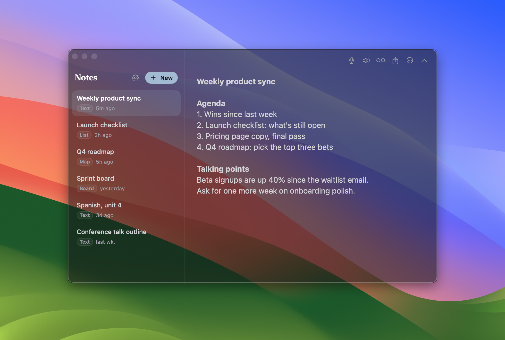

# Onionskin

[](https://buymeacoffee.com/prattsolutions)



A see-through note window that floats over other apps. Use it for an agenda during a video call, study notes next to a PDF, or figures beside a spreadsheet.

SwiftUI + AppKit, macOS 14+, no dependencies.

## Features

- **Transparency.** The background fades and the text stays solid. Set it in Settings > Window, or use ⌘[ / ⌘].
- **Float above other windows.** Toggle with ⌥⌘A.
- **Four note types:**
  - text notes with bold / italic / underline (⌘B ⌘I ⌘U)
  - lists: Return starts the next item
  - mind maps: double-click the canvas to add an idea, drag to arrange, double-click an idea to rename it
  - boards: drag cards by their grip, or move them from the context menu
- **Notes list, newest edit first.** Shows type tags and relative dates. Opening a note doesn't count as an edit.
- **Toolbar:**
  - Dictate, Read aloud
  - Focus: larger, read-only text for presenting
  - Share / Export
  - More: Details, Sync with iCloud Drive, Open in New Window, Delete
  - Collapse it with ⇧⌘T or the chevron; the grabber at the top brings it back.
- **Themes:**
  - dark: Carbon (the default), Slate, Ink, and Halo, which shadows letters for busy backgrounds
  - light: Fog, Paper
  - any installed font, 11–32 pt
- **Storage.** Each note is a JSON file in `~/Library/Application Support/Onionskin/Notes`.
  - Sync with iCloud Drive moves a note to `iCloud Drive/Onionskin`, so your other Macs get it too.

## Build

```sh
brew install xcodegen
make run       # generate the Xcode project, build Release, launch
make test      # unit tests
make install   # copy to /Applications/Onionskin.app
```

`make project && open Onionskin.xcodeproj` to work in Xcode.
